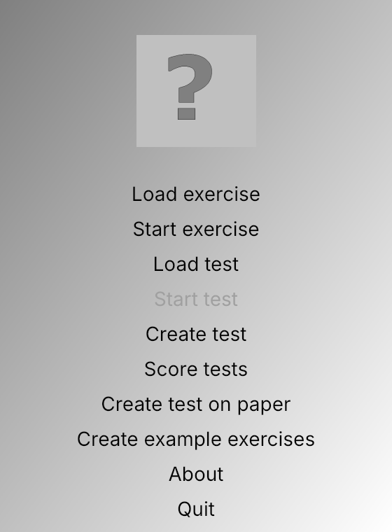

# Hometrainer

[](https://codecov.io/gh/richelbilderbeek/Hometrainer)

[](https://github.com/richelbilderbeek/Hometrainer/actions/workflows/build.yaml)

Hometrainer is a free suite to create exercises and tests,
to practice these, to examine with these and to grade these.
Exercises have open questions and multiple choice questions,
with or without images,
and are written in a simple text editor (such as Notepad).

[Go to the nicely rendered website](https://richelbilderbeek.github.io/Hometrainer/),
which has the Windows version to download and the documentation.



## Simple example of Hometrainer in creating exercises

Supply the program with a text file like shown below (note that the first line is obligatory):

```text
Hometrainer (C) 2009-2015 Richel Bilderbeek
Humanbody.bmp,Which line points to the liver?,1,2,3,4
Humanbody.bmp,Which line points to the liver?,1/one/One
Humanbody.bmp,Which organ does line 1 point to?,The liver/the liver/Liver/liver
-,In which organ is ethanol detoxified?,The liver/the liver/Liver/liver
```

The program will show you the image, the question and the (shuffled) answers.
You have to click the right answer. Great to train yourself in nearly anything!

## Build

Hometrainer needs Qt and a C++17 compiler:

```bash
qmake ToolHometrainerDesktop.pro
make
```

Project                                                   | Description
----------------------------------------------------------|------------------------------------
[ToolHometrainerDesktop.pro](ToolHometrainerDesktop.pro)  | The desktop version
[ToolHometrainerConsole.pro](ToolHometrainerConsole.pro)  | The command line version
[ToolHometrainerTest.pro](ToolHometrainerTest.pro)        | The tests, build in debug mode

[build.yaml](.github/workflows/build.yaml)
shows how the Linux and Windows versions are built and tested.

## Manual

The manual of Hometrainer 2: [doc](doc/ToolHometrainerManual.doc) [odt](doc/ToolHometrainerManual.odt) [pdf](doc/ToolHometrainerManual.pdf).
The [website](https://richelbilderbeek.github.io/Hometrainer/) has the up-to-date documentation.

## Links to similar freeware programs

- [Quiz](http://www.luziusschneider.com/QuizHome.htm): for multiple-choice questions only
- [Questiontools Suite](http://www.questiontools.org/): extensive test generation suite, but commercial for companies

## Files used by continuous integration scripts

Filename                                  |Descriptions
------------------------------------------|--------------------------------------------------------------------------------------------------------------------------------------
[mlc_config.json](mlc_config.json)        |Configuration of the link checker, use `markdown-link-check --config mlc_config.json --quiet docs/**/*.md` to do link checking locally
[.spellcheck.yml](.spellcheck.yml)        |Configuration of the spell checker, use `pyspelling -c .spellcheck.yml` to do spellcheck locally
[.wordlist.txt](.wordlist.txt)            |Whitelisted words for the spell checker, use `pyspelling -c .spellcheck.yml` to do spellcheck locally
[.markdownlint.jsonc](.markdownlint.jsonc)|Configuration of the markdown linter, use `markdownlint "**/*.md"` to do markdown linting locally. The name of this file is a default name.
[.markdownlintignore](.markdownlintignore)|Files ignored by the markdown linter, use `markdownlint "**/*.md"` to do markdown linting locally. The name of this file is a default name.
