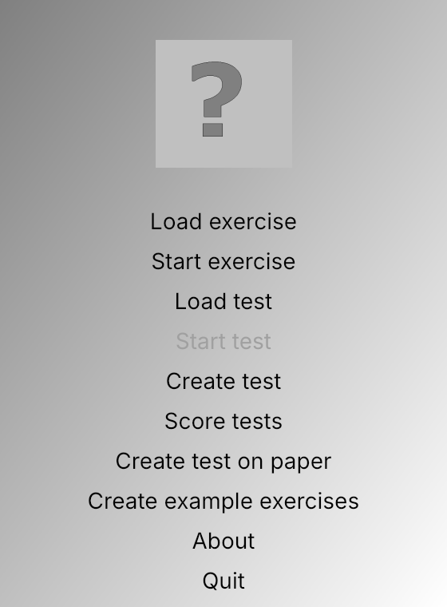
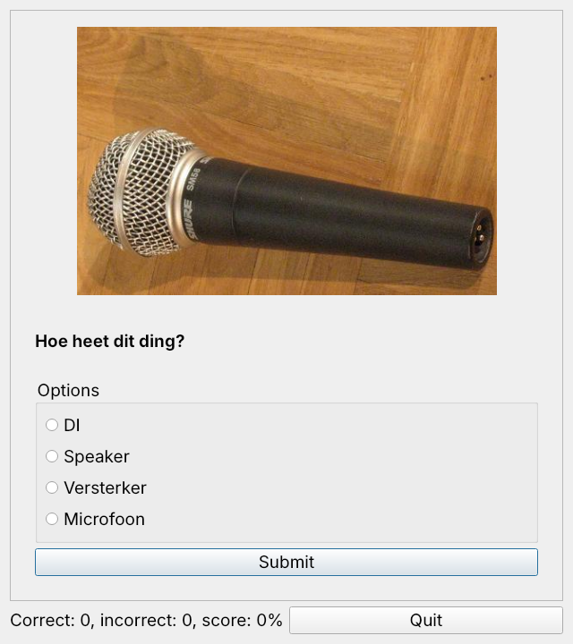

# Hometrainer

Hometrainer is a free suite to create exercises and tests,
to practice these, to examine with these and to grade these.
Exercises have open questions and multiple choice questions,
with or without images,
and are written in a simple text editor (such as Notepad).



Hometrainer can:

- [do exercises](exercises.md): practice, with feedback after each answer
- [create, take and score tests](tests.md): encrypted tests, whose results are
  graded automatically
- [create tests on paper](tests_on_paper.md): print a test,
  with an optional answer code that makes grading easier
- be used [from the command line](command_line.md)

## Run or download

- [Run Hometrainer in your web browser](run.md)
- [Download the Windows version](https://richelbilderbeek.github.io/Hometrainer/hometrainer_windows.zip):
  unzip it and run `ToolHometrainerDesktop.exe`
- [Example exercises](https://github.com/richelbilderbeek/Hometrainer/tree/main/examples),
  or click 'Create example exercises' in the main menu
- Linux and macOS: [build Hometrainer from source](build.md)

## A simple exercise

An exercise is a text file like the one below, where the first line is obligatory:

```text
Hometrainer (C) 2009 Richel Bilderbeek
Humanbody.png,Which line points to the liver?,1,2,3,4
Humanbody.png,Which line points to the liver?,1/one/One
Humanbody.png,Which organ does line 1 point to?,The liver/the liver/Liver/liver
-,In which organ is ethanol detoxified?,The liver/the liver/Liver/liver
```

Hometrainer shows you the image, the question and the (shuffled) answers.
Great to train yourself in nearly anything!
See [exercises](exercises.md) how to write your own.



## Links

- [Hometrainer source code](https://github.com/richelbilderbeek/Hometrainer)
- [HometrainerVcl](https://github.com/richelbilderbeek/HometrainerVcl):
  the original Hometrainer 2 suite, written in C++ Builder
- [History](history.md) of Hometrainer
