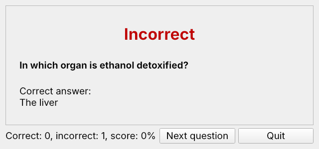

# Exercises

An exercise is a collection of questions to practice with.
Hometrainer asks the questions in a random order, over and over again,
and tells you after each answer if it was correct.
If not, it shows the correct answer.



## Doing an exercise

1. Start Hometrainer
2. Click 'Load exercise' and select an exercise file
3. Click 'Start exercise'

The score so far is shown at the bottom.
Click an image to see it full size.
Press Escape or click 'Quit' to stop.

To get some example exercises, click 'Create example exercises'
and select a folder.

## Writing an exercise

An exercise is a plain text file that can be written with any text editor,
such as Notepad.
The images are not part of the exercise file:
put these in the same folder as the exercise file.

```text
Hometrainer (C) 2009 Richel Bilderbeek
Alphabet.png,What is the first letter of the alphabet?,A,B,C,D
-,What is the first letter of the alphabet?,A,B,C,D
Alphabet.png,What is the first letter of the alphabet?,A/a
-,What is the first letter of the alphabet?,A/a
-,What is 1\,5 + 1\,5?,3
```

The first line must start with `Hometrainer`.
Every other line is one question, which consists of fields that are
separated by commas.

### Multiple choice questions

A multiple choice question has these fields:

1. The filename of the image, or a minus sign (`-`) for no image
2. The question
3. The correct answer
4. One or more wrong answers

The answers are shown in a random order.

### Open questions

An open question has these fields:

1. The filename of the image, or a minus sign (`-`) for no image
2. The question
3. The correct answer, or multiple correct answers separated by slashes (`/`)

The answer of an open question is case-sensitive:
supply the same answer in multiple ways
if you want to accept these, for example `A/a`.
Spaces before and after an answer are ignored.

### Tips

- A question must be on one line. In Notepad,
  it might be a good idea to turn off word wrapping
- Use `\,` for a comma that is part of a question or answer,
  for example `What is 1\,5 + 1\,5?`
- Lines that are no valid question (for example, an empty line) are ignored
- In the main menu, click 'About', then 'Show Details...' to see an example
