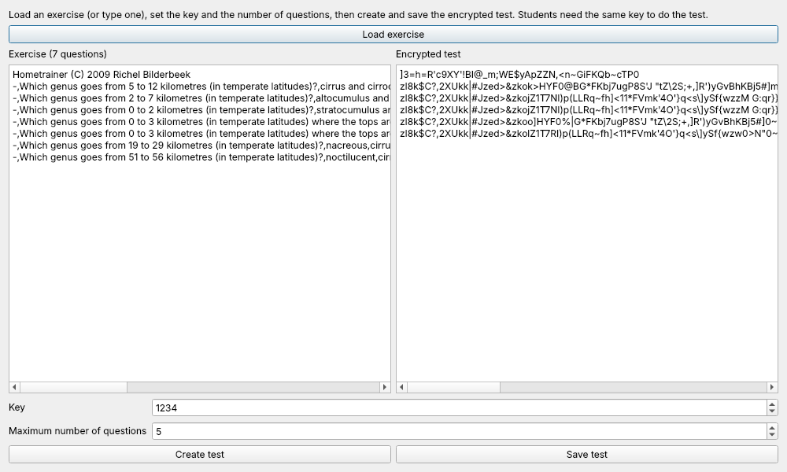
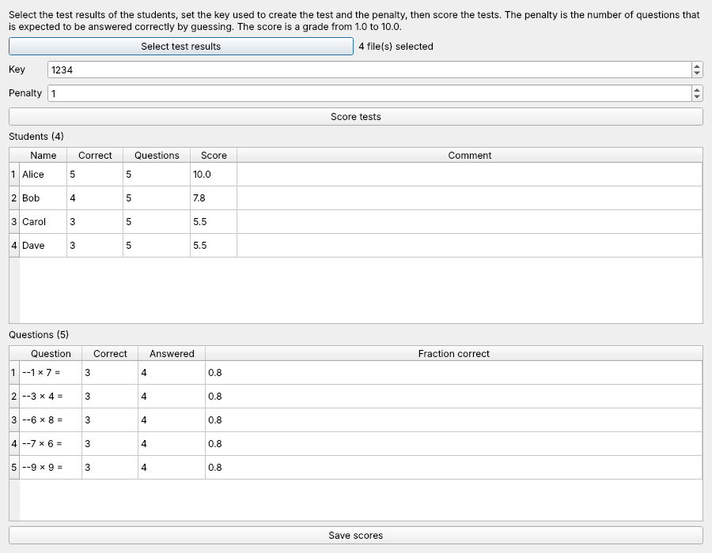

# Tests

A test is an exercise used for examination:

- the teacher creates an encrypted test from an exercise
- each student does the test once, without seeing if the answers are correct;
  the results are saved encrypted
- the teacher scores the results of all students at once

The encryption prevents students from reading the answers in the test file,
or changing their results.
The encryption uses a key (a whole number) that only the teacher knows,
and that is given to the students at the start of the test.

## Creating a test



1. In the main menu, click 'Create test'
2. Click 'Load exercise' and select an exercise,
   or type an exercise
3. Set the key and the maximum number of questions.
   The questions are selected at random
4. Click 'Create test', then 'Save test'

Put the images used by the test in the same folder as the test.

## Taking a test

1. In the main menu, click 'Load test' and select the test
2. Type the key the teacher gave you
3. Click 'Start test'
4. Type your full name and select the folder to save your results in

Each question is asked once.
After every answer, the results are saved to a file named after you,
for example `John Doe.txt`.
Hand in this file to your teacher.

## Scoring tests



1. In the main menu, click 'Score tests'
2. Click 'Select test results' and select the results of all students
3. Set the key used to create the test
4. Set the penalty: the number of questions that is expected to be
   answered correctly by guessing, see below
5. Click 'Score tests'
6. Click 'Save scores' to save the scores as comma-separated files,
   that can be opened by a spreadsheet program

Hometrainer shows the scores per student and per question.
The scores per question show which questions were difficult.

### Grading

The grade is a number from 1.0 to 10.0, calculated as:

```text
grade = 1 + 9 * (correct - penalty) / (questions - penalty)
```

The penalty corrects for guessing.
For example, for a test with 20 multiple choice questions with 4 options each,
5 questions are expected to be answered correctly by guessing,
so use a penalty of 5.
A grade below 1.0 is rounded up to 1.0.

### Suspicious results

A student that renames the results file (for example, to hand in the results
of someone else) gets a 1.1, with a comment that the filename differs
from the name in the results.
If no name is found in the results, for example because of an incorrect key,
the student gets a 1.0 with a comment.
