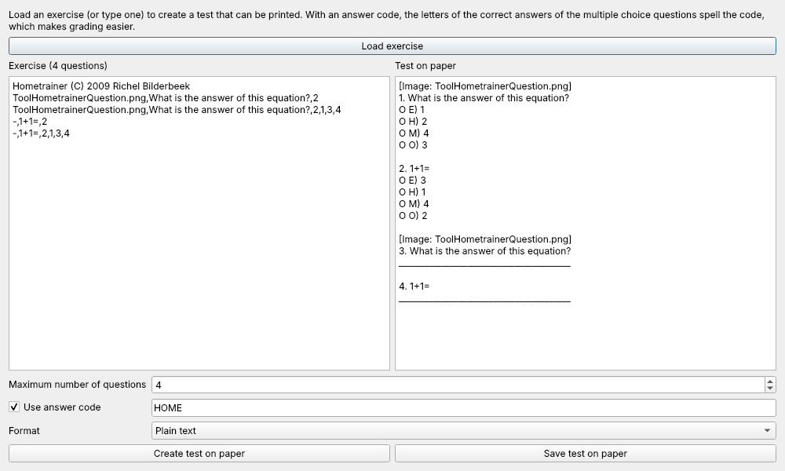

# Tests on paper

Hometrainer can create a test on paper from an exercise.
The questions are selected at random and numbered.
Multiple choice questions show their answers sorted,
open questions get a line to write the answer on.



1. In the main menu, click 'Create test on paper'
2. Click 'Load exercise' and select an exercise, or type an exercise
3. Set the maximum number of questions
4. Optionally, set an answer code, see below
5. Select the format:
    - HTML: a web page with images, that can be printed by a web browser
      or opened by a word processor
    - Plain text
6. Click 'Create test on paper', then 'Save test on paper'

Save an HTML test in the same folder as the images, so that these are shown.

## Answer code

With an answer code, each answer of a multiple choice question
gets a letter.
The letters of the correct answers spell the answer code,
which makes grading easier.

For example, with answer code `HOME`, the correct answer
of question 1 is `H`, of question 2 is `O`, of question 3 is `M`,
of question 4 is `E`, of question 5 is `H` again, and so on:

```text
1. What is 1+1?
O E) 3
O H) 2
O M) 4
O O) 1

2. What is 1+2?
O E) 4
O H) 1
O M) 2
O O) 3
```

The wrong answers get the other letters of the answer code,
so all answers look alike.
